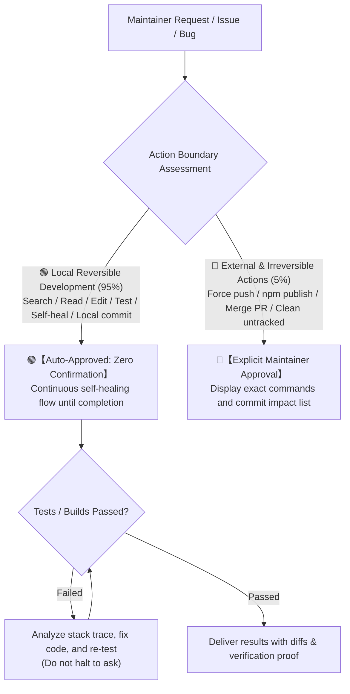

# Antigravity Open-Source Maintainer (`antigravity-open-source-maintainer`)

Autonomous execution protocol and auto-approval boundaries for **Google Antigravity**, tailored specifically for open-source maintainers and developers.

---

## ⚡ The Maintainer's Problem

When developing open-source software with AI agents, the biggest friction is constant hesitation and premature pauses:
- *"I have created a plan, may I proceed?"*
- *"A unit test failed, would you like me to fix it?"*
- *"I edited the file, should I commit it to git?"*

These constant interruptions break focus. Open-source maintainers need an agent that **works autonomously through local reversible steps (code, test, build, self-heal, commit)** while strictly gating **irreversible, high-risk external actions** (force push, package publishing, public PR merges).

---

## 🛡️ The Two-Tier Boundary System



---

## 🟢 1. Auto-Approved Zone (Zero Confirmation)

For these local operations, the agent advances without asking:
1. **Investigation**: Code search (`rg`), file reading, AST analysis, git log/diff inspection.
2. **Implementation**: Writing code, refactoring modules, adding tests, updating docs.
3. **Validation & Self-Healing**:
   - Running test suites, linters, type checks, and local builds.
   - **Self-Healing Loop**: If a test or build fails, the agent inspects the error, fixes the code, and re-runs tests without asking for permission.
4. **Local Git Workflow**: Creating local feature branches, staging files, and committing with Conventional Commits.
5. **Local Experiments**: Writing scratch verification scripts and running headless browser checks.

---

## 🔴 2. Explicit Approval Red Lines (The Maintainer's Guardrails)

Confirmation is mandatory **only** when touching the project's public reputation, data integrity, or credentials:

| Boundary | Trigger Scenario | Why Approval Is Required |
| :--- | :--- | :--- |
| **Remote History** | `git push --force` or overwriting remote branches | Prevents destroying collaborator commits or existing releases. |
| **Package Publishing** | `npm publish`, `cargo publish`, `pip upload` | Public package releases are irreversible on most registries. |
| **Production Release** | Pushing release tags (e.g. `v1.0.0`) triggering CI/CD | Prevents unverified builds from triggering production release pipelines. |
| **Community Actions** | Publicly commenting on Issues, merging PRs, closing PRs | The agent must not speak or merge unvetted code under the maintainer's name without signoff. |
| **Destructive Cleaning** | `git clean -fdx`, `git reset --hard`, deleting unmerged branches | Protects untracked experiments and uncommitted ideas from accidental loss. |
| **Secret Protection** | Committing `.env`, private keys, API keys, or access tokens | Prevents credential leaks on public repositories. |

---

## 📂 Repository Structure

```text
antigravity-open-source-maintainer/
├── README.md
├── rules/
│   └── AGENTS.md                                # Global always-on maintainer rules
└── skills/
    └── open-source-maintainer/
        ├── SKILL.md                             # Protocol specification
        └── references/
            ├── approval-boundaries.md           # Command classification cheat sheet
            └── release-safety.md                # Release checklists and secret prevention
```

---

## 🛠️ Quick Installation

### Global Setup (Recommended)
Copy the skill and rule to your global Antigravity customization folder:

**Windows (PowerShell):**
```powershell
New-Item -ItemType Directory -Force "$env:USERPROFILE\.gemini\config\skills"
Copy-Item -Recurse -Force ".\skills\open-source-maintainer" "$env:USERPROFILE\.gemini\config\skills\"

# Append rule to global AGENTS.md
Get-Content ".\rules\AGENTS.md" | Add-Content "$env:USERPROFILE\.gemini\config\AGENTS.md"
```

**macOS / Linux:**
```bash
mkdir -p ~/.gemini/config/skills
cp -r ./skills/open-source-maintainer ~/.gemini/config/skills/
cat ./rules/AGENTS.md >> ~/.gemini/config/AGENTS.md
```

### Workspace Setup
Place `AGENTS.md` in your repository root and the skill under `.agents/skills/open-source-maintainer/`.
