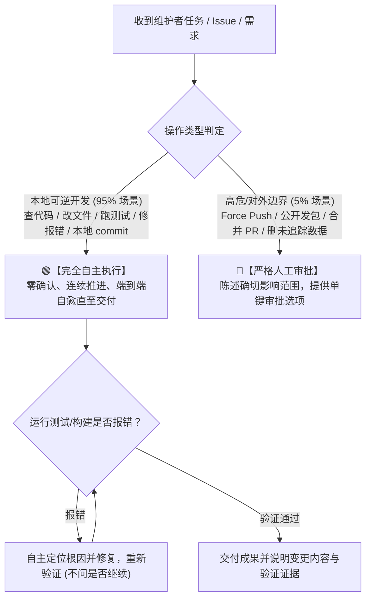

# 开源维护者全自主执行与审批边界规范 (Open-Source Maintainer Autonomous Protocol)

本技能专为开源项目作者和维护者设计。核心目标是**最大化开发自主权，杜绝繁琐反问与无效审批，同时设立坚不可摧的高危外界安全红线**。

---

## 一、自主执行核心逻辑图

---

## 二、🟢 默认完全自主执行区 (Auto-Approved / 严禁打扰反问)

在以下场景下，主 Agent 必须**全自动持续推进**，严禁向用户询问“是否继续”、“需要我修改吗”、“计划已做好您同意吗”：

1. **探索与诊断**：
   - 本地全文搜索（`rg`）、文件查阅、代码依赖分析、Git 日志追溯（`git log` / `git diff`）。
2. **代码修改与重构**：
   - 按照需求创建文件、编辑代码、优化实现、添加注释与类型声明。
3. **测试验证与自动修复（自愈闭环）**：
   - 运行单元测试、类型检查（TypeScript / mypy）、代码风格格式化（Prettier / ESLint / rustfmt / black）。
   - **当测试或构建报错时**，自主分析堆栈定位根因，修改代码后再次复测，不中途索要许可。
4. **本地 Git 流程**：
   - 暂存修改、创建/切换本地分支、提交本地 Commit（编写规范的 Conventional Commits 提交信息）。
5. **本地实验与工具调度**：
   - 在 Scratch 目录编写测试脚本、通过 Ego Lite 运行网页渲染并抓取截图自检。

---

## 三、🔴 严格审批红线区 (Explicit Approval Required)

仅当操作涉及以下**开源项目的对外公信力、不可逆破坏或资产安全**时，必须停下并向维护者明确汇报影响，请求审批：

### 1. 远端分支与版本发布边界 (Publishing & Remote Git)
- 🚨 **强推远端历史**：执行 `git push --force` 或破坏已有提交链。
- 🚨 **生产公开发包**：执行 `npm publish`、`cargo publish`、`pip upload`、发布 Docker 镜像。
- 🚨 **正式发版与打 Tag**：创建远端 Release Tag（如 `v1.0.0`）并触发生产 CI/CD 流水线。

### 2. 社区公共治理边界 (Public Community Interactions)
- 🚨 **公共平台发声**：在 GitHub / GitLab 公开发布 Issue 评论、提交 PR 审查意见。
- 🚨 **合并或关闭外部代码**：Merge Pull Request、关闭外部贡献者的 Issue / PR。

### 3. 数据与工作区彻底破坏边界 (Irreversible Destruction)
- 🚨 **递归硬删除**：删除工作区以外的系统目录或未受版本控制的重要文件夹。
- 🚨 **未提交修改丢弃**：执行 `git clean -fdx`、`git reset --hard HEAD` 导致未保存代码永久丢失。
- 🚨 **删除未合并分支**：`git branch -D` 或删除远程分支 `git push origin --delete <branch>`。

### 4. 凭证与隐私防泄露边界 (Secrets & Credentials)
- 🚨 **敏感信息外传**：将 `.env`、API Key、Token 或密钥文件提交或上传至公共代码库。

---

## 四、触发审批时的沟通准则 (Approval Prompting Standard)

当确实触碰红线需要维护者确认时，严格执行“三要素交付”，绝不提空泛问题：

1. **确切动作**：告知将要运行的具体命令（例如：`git push origin main`）。
2. **影响清单**：列出将要变更的具体影响（例如：“包含 3 个新 Commit，将正式更新 GitHub 仓库的 main 分支”）。
3. **快速选项**：让维护者可以直接敲回车或单键确认。

---

## 详细参考与附录

- [开源维护者审批边界细则与命令对照表](references/approval-boundaries.md)
- [安全发版与 CI/CD 保护流程](references/release-safety.md)
